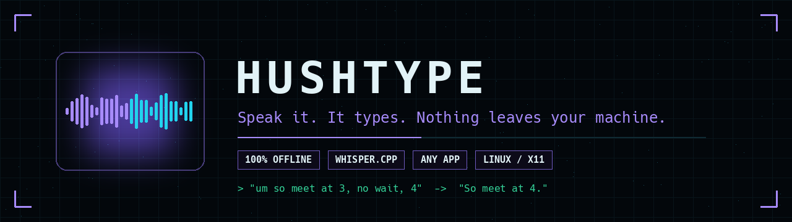
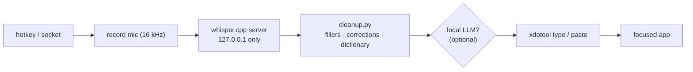

<p align="center">
  
</p>

<p align="center">
  
  
  
  
</p>

<p align="center"><b>Private voice typing for Linux. Hold a key, talk naturally, let go, and clean text appears in whatever app you're using.</b></p>

---

## `> WHAT IT IS`

**HushType** is push-to-talk dictation that never leaves your computer:
- **Whisper** (via whisper.cpp) turns your speech into text locally.
- A fast, rule-based **cleanup engine** turns rambling speech into tidy sentences.
- The result is **typed into the focused window**: terminal, browser, editor, chat or anything else.

```text
  hold Right Ctrl ──▶ 🎙️ "um so I think we should, uh, ship it"
  release         ──▶ 🧠 whisper.cpp (local) ──▶ ✨ cleanup ──▶ ⌨️  "So I think we should ship it."
```

## `> WHY I BUILT IT`

For most people, talking is several times faster than typing, and voice typing became one of my favourite productivity tools. The best apps for it run in the cloud, though, and that means **every word you say is uploaded to someone else's server.** That includes private notes, work, and the occasional password you read out by mistake.

I wanted the same "just talk and it types" feeling with **no cloud, no account and no subscription**, running on a Raspberry Pi 5. HushType is the result. It also gives my voice assistant [A.L.I.S.H.A.](https://github.com/Vats-Ankur/ALISHA) its hearing: she uses HushType's Whisper server and cleanup rules to understand commands accurately.

## `> FEATURES`

| | |
|---|---|
| 🔒 **100% offline** | Audio and text stay on your machine. The only optional extra is a *local* LLM. |
| ⚡ **Push-to-talk** | Hold **Right Ctrl** to talk and release to type. Toggle mode is available too. |
| 🧹 **Smart cleanup** | Removes filler words, applies spoken corrections, fixes punctuation and capitalisation, and understands "new line". |
| 📖 **Personal dictionary** | Teach it how you write names and jargon ("get hub" → "GitHub"). |
| ⌨️ **Works everywhere** | Types into any X11 window through `xdotool`, or pastes long text in one go (and handles terminals correctly). |
| 🗣️ **Voice trigger API** | Other programs can start dictation through a Unix socket, for example a voice assistant ("Alisha, type"). |
| 🧪 **Tested rules** | The cleanup rules have their own test suite (`test_cleanup.py`). |

### Speaking tricks
| You say | You get |
|---|---|
| "um", "uh", "hmm" | *(removed)* |
| "meet at 3, **no wait**, 4" | "Meet at 4." (also "sorry I mean", "I mean, no", "correction") |
| "…**scratch that**…" | the previous sentence is dropped (also "delete that", "strike that") |
| "**new line**" / "**new paragraph**" | line breaks |

## `> QUICK START`

```bash
git clone https://github.com/Vats-Ankur/hushtype.git && cd hushtype
./setup.sh                 # builds whisper.cpp, downloads the base.en model, creates the Python venv
./run.sh                   # start, then hold Right Ctrl and talk
```

You'll need Linux with **X11**, a microphone, and `xdotool`, `notify-send`, PipeWire or PulseAudio, git, cmake and a C++ compiler. `xclip` is needed only for paste mode.

```bash
./run.sh --file sample.wav     # transcribe a file and print the result
python3 test_cleanup.py        # run the cleanup rule tests
```

### Run it at login (systemd user service)
```bash
cp systemd/hushtype.service ~/.config/systemd/user/
systemctl --user enable --now hushtype
journalctl --user -u hushtype -f      # live log: raw and cleaned text
```
The service file assumes the project is at `~/Documents/HushType/hushtype`, so edit the paths if yours is elsewhere. Don't run `./run.sh` while the service is up, because both would grab the hotkey.

## `> CONFIGURATION` — `config.toml`

| Setting | What it does |
|---|---|
| `hotkey.key` / `hotkey.mode` | Any pynput key name (`ctrl_r`, `f9`, `pause`…). `hold` = talk while held; `toggle` = press to start and stop. |
| `whisper.model` | `base.en` by default. Run `./setup.sh small.en` for higher accuracy (about 3× slower). |
| `whisper.prompt` | Hint words Whisper should expect, such as names you say often. |
| `output.method` | `type` (xdotool) or `paste` (clipboard, faster for long text). |
| `output.end_silence` | Seconds of quiet that end a voice-triggered recording. |
| `[dictionary]` | Spoken phrase → written form. Matching ignores case and works on whole words. |
| `[llm]` | *Optional* polish through a **local** OpenAI-compatible server (Ollama, llama.cpp). Off by default. |

## `> INTEGRATION API`

Other local programs can control HushType through a Unix datagram socket.

| Path | Purpose |
|---|---|
| `$XDG_RUNTIME_DIR/hushtype.sock` | Send `listen` (record until a pause, then type) or `text:<words>` (type the words directly) |
| `$XDG_RUNTIME_DIR/hushtype.busy` | Exists while HushType is recording or transcribing, so other apps can stay quiet |

```bash
python3 -c "import socket,os; s=socket.socket(socket.AF_UNIX,socket.SOCK_DGRAM); s.sendto(b'listen', os.environ['XDG_RUNTIME_DIR']+'/hushtype.sock')"
```

The Whisper server listens on `127.0.0.1:8178` only, so companion apps on the same machine can reuse it.

## `> HOW IT WORKS`



## `> PROJECT FILES`

```text
hushtype.py         daemon: hotkey, recording, Whisper client, typing, voice-trigger socket
cleanup.py          rule-based text cleanup (no network, no model)
test_cleanup.py     cleanup test cases
config.toml         settings and personal dictionary
setup.sh / run.sh   one-time setup / launcher
systemd/            user service unit
```

## `> ROADMAP`

- [ ] Wayland support (ydotool / wtype)
- [ ] Live partial transcripts while you speak
- [ ] Per-app profiles (code vs. chat vs. email)
- [ ] One-line installer

## `> LICENSE & CREDITS`

Created by **Ankur Vats** ([@Vats-Ankur](https://github.com/Vats-Ankur)).

- **License:** [Apache License 2.0](LICENSE). You're free to use, study and build on HushType. Keep the [NOTICE](NOTICE) file and credit the original author.
- **The name:** "HushType" is this project's name and is **not** licensed. If you publish a modified version, give it your own name.

Powered by [whisper.cpp](https://github.com/ggml-org/whisper.cpp) and OpenAI's open Whisper models (MIT). Previously developed under the working name *LocalFlow*. On the author's Pi, the old paths and the `localflow` service name remain as aliases.

<p align="center"><sub><code>// Speak it. It types. Nothing leaves your machine.</code></sub></p>
